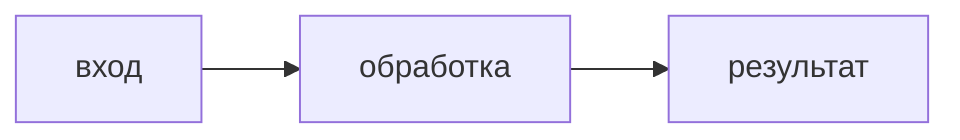

# План: <название>

## Цель

<Один абзац: что строим, для кого. Что явно НЕ делаем в этой работе.>

## Шаги

| ID | Шаг | Видимый результат | Статус |
|----|-----|-------------------|--------|
| S1 | MVP: <сценарий от начала до конца> | <что заказчик увидит руками> | ⬜ |
| S2 | ... | ... | ⬜ |
| S3 | ... | ... | ⬜ |

Статусы: ⬜ не начат · 🔵 в работе · ✅ принят заказчиком

## Текущий шаг: S<N>

### Что меняется
- Файлы/части: <создаётся X, меняется Y>
- Не трогаем: <...>

### Пример входа и выхода
Вход: <конкретный пример>
Выход: <конкретный пример>

### Критерии приёмки
- Дано <...>, когда <...>, тогда <...>
- Дано <...>, когда <...>, тогда <...>

### Допущения
- <допущение> — подтвердить у заказчика / принято молчанием

### Схема (если шаг нетривиален)

