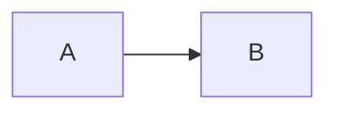

# Отчёт шага S<N>: <название шага>

Дата: <YYYY-MM-DD> · Правила: коммит <short-hash>

## 1. Что теперь умеет система

<2–3 фразы человеческим языком. Без имён функций, классов и файлов.>

## 2. Как проверить самому

1. Запусти: `<команда>` / открой `<адрес>`
2. Сделай: <действие>
3. Ожидаемый результат: <что должно появиться/произойти>

(повтори для каждого критерия приёмки)

## 3. Что изменилось в структуре

<Только если появились новые части. Иначе: "Структура не менялась.">

## 4. Сверх задачи и упрощения

### По инициативе ИИ
| Что сделано | Почему | Пункт плана |
|-------------|--------|-------------|
| <...> | <...> | S<N> / **нет — инициатива** |

(если пусто — написать "Ничего сверх задачи.")

### Заглушки, добавленные на этом шаге
- <что упрощено> → записано в STUBS.md под ID T<N>

## Автопроверки

- Линтер: ✅/❌  · Статанализ: ✅/❌ · Тесты: ✅/❌ (<N> прошло)
